# Post-contenido — Unidad 7: Gestión de Tareas con Spring Boot

## Información del Estudiante
* **Nombre:** Andrea Valentina Rivera Fernández
* **Código:** 1152444
* **Institución:** Universidad Francisco de Paula Santander (UFPS)
* **Carrera:** Ingeniería de Sistemas
* **Materia:** Programación Web
* **Unidad:** 7
* **Año:** 2026


## Descripción

Repositorio del laboratorio de la Unidad 7 de Programación Web. Contiene un
único proyecto Spring Boot (`gestion-tareas`, paquete raíz
`com.universidad.tareas`) con dos capas sobre el mismo `TareaService`: una
vista web con Thymeleaf (`@Controller`, Parte 1) y una API REST
(`@RestController`, Parte 2).

**Tecnologías:** Java 17, Spring Boot 3, Spring Web, Thymeleaf, Bean
Validation, Maven.

## Parte 1 — Vista Thymeleaf con @Controller

`TareaController` expone `/tareas` con filtrado por `@RequestParam`
(`prioridad`, `completada`), formularios validados con `@Valid` y
`BindingResult`, y las acciones completar y eliminar implementadas como POST
(no GET) con el patrón Post/Redirect/Get.

## Parte 2 — API REST con @RestController

`TareaApiController` expone `/api/tareas` con los verbos GET, POST, PUT, PATCH
y DELETE, e inyecta por constructor la misma instancia de `TareaService` que
usa la Parte 1. `ApiErrorHandler` traduce los errores de `@Valid` en JSON
estructurado (400 Bad Request).

## Endpoints de la API

| Método | URL | Éxito | Error | Descripción |
|---|---|---|---|---|
| GET | `/api/tareas` | 200 OK | — | Lista, filtrable con `?prioridad=` y `?completada=` |
| GET | `/api/tareas/{id}` | 200 OK | 404 | Devuelve una tarea |
| POST | `/api/tareas` | 201 Created | 400 | Crea una tarea (valida el body) |
| PUT | `/api/tareas/{id}` | 200 OK | 404 / 400 | Reemplaza todos los campos |
| PATCH | `/api/tareas/{id}/completar` | 200 OK | 404 | Marca solo `completada = true` |
| DELETE | `/api/tareas/{id}` | 204 No Content | 404 | Elimina la tarea |

## Estructura del proyecto

```
rivera-post1-u7/
├── pom.xml
├── README.md
├── capturas/
└── src/main/
    ├── java/com/universidad/tareas/
    │   ├── TareasApplication.java
    │   ├── model/        Tarea, Prioridad
    │   ├── service/      TareaService
    │   └── controller/   TareaController, TareaApiController, ApiErrorHandler
    └── resources/
        ├── application.properties
        └── templates/tareas/   lista.html, formulario.html
```

## Decisiones de diseño

- **Inyección por constructor, no `@Autowired` en el campo.** Hace explícita
  la dependencia y permite probar el controlador creándolo a mano con un
  servicio de prueba, sin levantar el contexto de Spring.
- **`@FutureOrPresent` en lugar de `@Future`.** Una tarea que vence el mismo
  día en que se crea es válida; `@Future` la rechazaría.
- **POST (no GET) para completar y eliminar.** Una petición GET debe ser
  segura. Si borrara datos, un rastreador o el prefetch del navegador podría
  eliminar tareas solo con visitar el enlace.
- **PATCH (no PUT) para completar.** Es una actualización parcial de un solo
  campo; PUT obligaría a reenviar todos los demás campos.
- **Validación distinta por capa.** `BindingResult` en la vista, para volver a
  mostrar el formulario con un mensaje junto a cada campo; `@RestControllerAdvice`
  en la API, para devolver JSON. Cada capa responde en el formato que le
  corresponde, aunque ambas comparten las mismas reglas del modelo.
- **Un único `TareaService` singleton compartido.** La vista y la API usan los
  mismos datos en memoria. Lo creado o eliminado por una capa se ve en la otra.
- **Campo oculto `completada` en el formulario.** Evita que editar una tarea
  ya completada la deje como pendiente.
- **Persistencia en memoria (`Map`).** La persistencia real con JPA/Hibernate
  se introduce en la Unidad 8.
- **Spring Boot 4.1.2 y propiedad de Jackson.** Se usó Spring Boot 4.1.2 
  porque el generador solo ofrecía la línea 4.x. Jackson 3 rechaza `null`
  en campos `boolean` primitivos, así que se agregó
  `spring.jackson.deserialization.fail-on-null-for-primitives=false` para
  que un POST sin el campo `completada` funcione.

## Prerrequisitos

- JDK 17 o superior
- Maven 3.8+ (o el wrapper `mvnw` incluido)
- IntelliJ IDEA, Git y un navegador
- `curl` o Postman para probar la API

## Cómo compilar y ejecutar

1. Clonar el repositorio:
   ```
   git clone https://github.com/Andrea-Rivera31/rivera-post1-u7.git
   ```
2. Abrir la carpeta como proyecto Maven en IntelliJ IDEA.
3. Ejecutar la aplicación:
   ```
   ./mvnw spring-boot:run
   ```
   (o el botón ▶ de `TareasApplication`).
4. Vista web: http://localhost:8080/tareas
5. API REST: http://localhost:8080/api/tareas

## Capturas de pantalla

### Parte 1 — Vista Thymeleaf

Arranque de la aplicación:

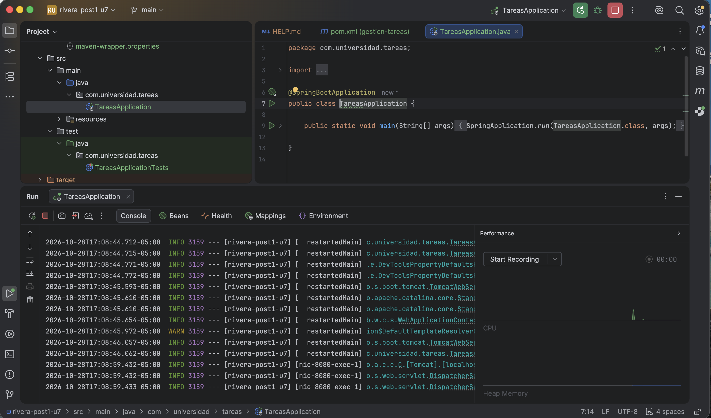

Lista inicial con las 3 tareas:

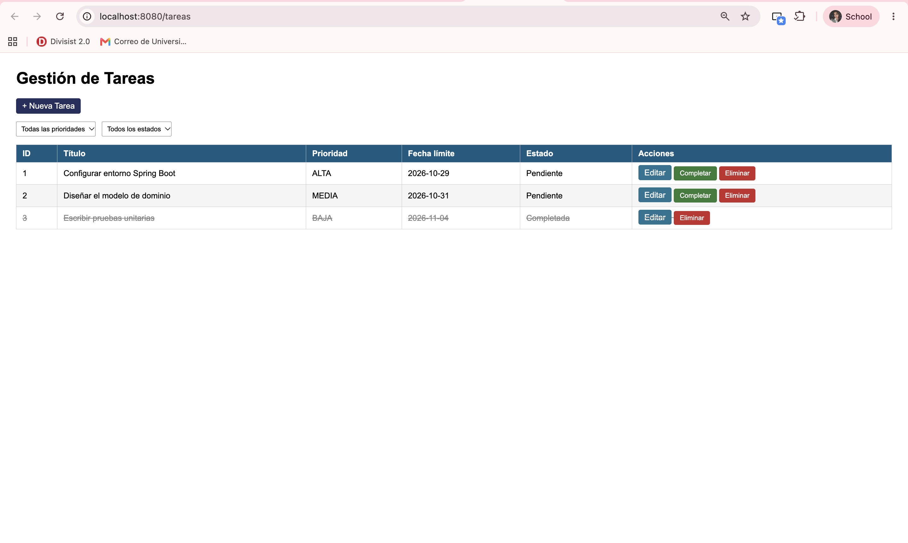

Filtro por prioridad y estado (`@RequestParam`):

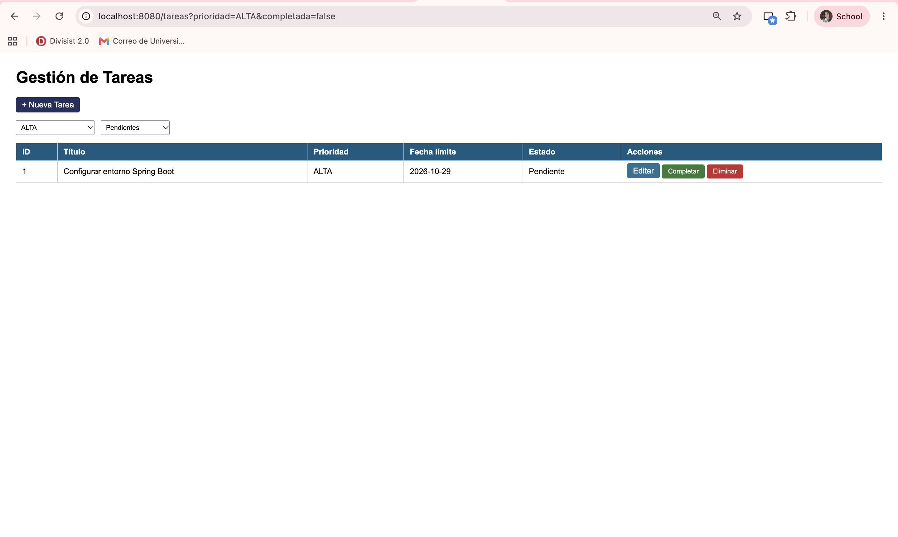

Formulario con errores de validación y datos conservados:

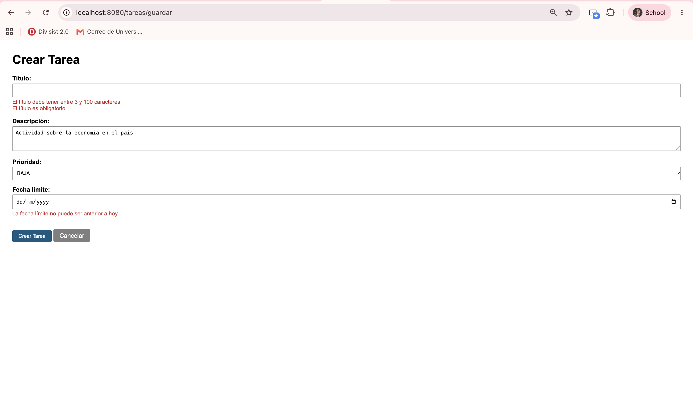

Tarea creada (redirect, patrón PRG):

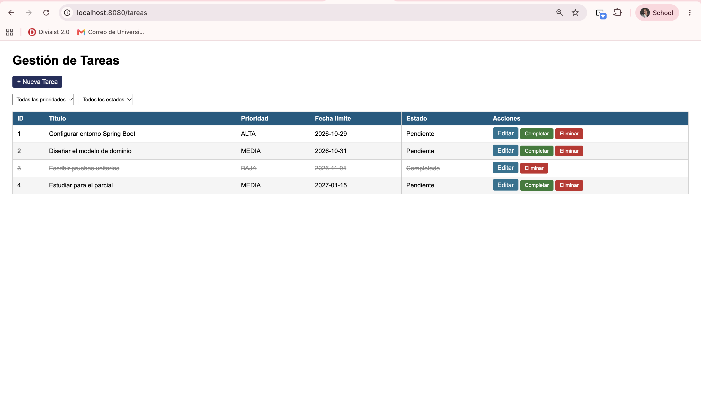

Edición con el formulario prellenado:

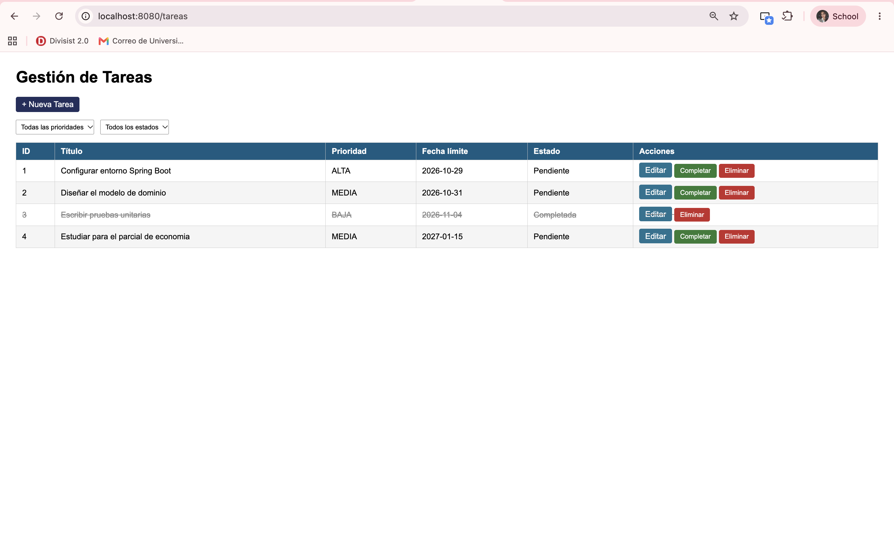

Tarea completada (el botón desaparece):

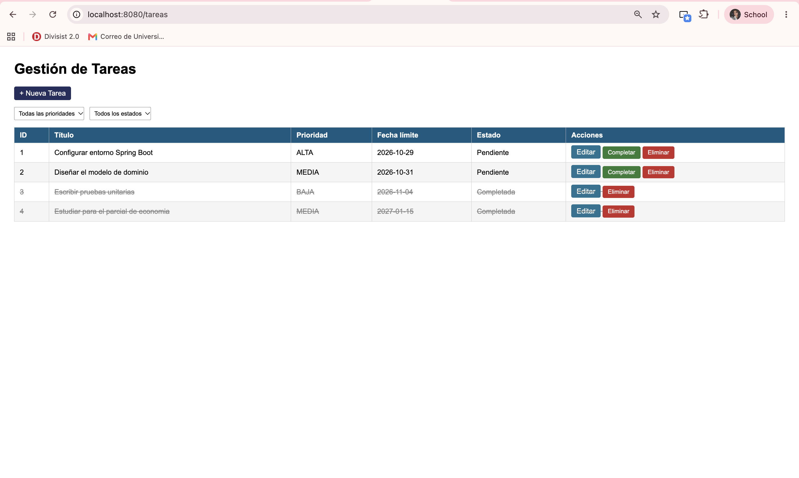

Historial de commits de la Parte 1:

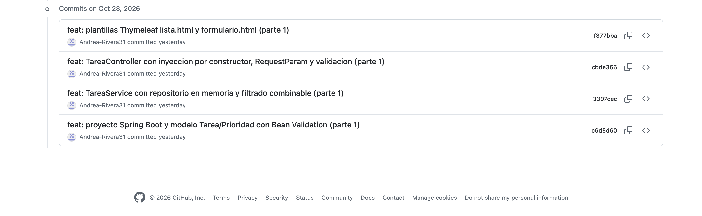

### Parte 2 — API REST

GET con filtros (200):

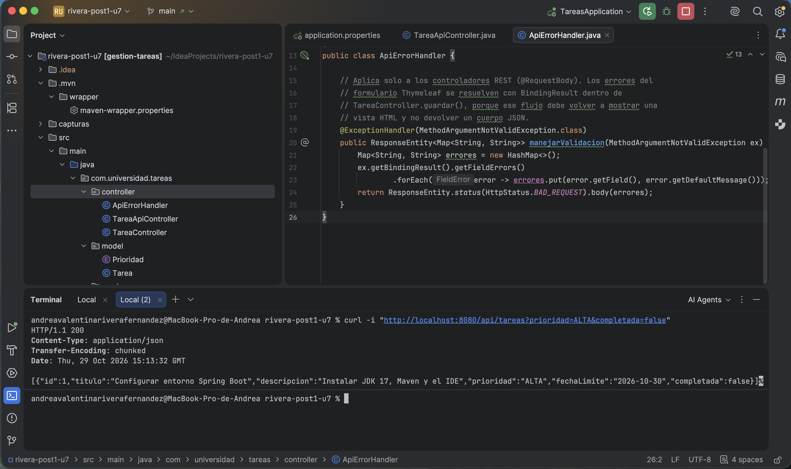

POST válido (201 Created con Location):

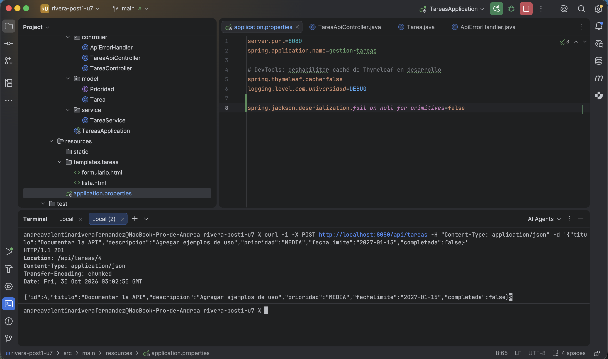

POST inválido (400 con JSON de errores):

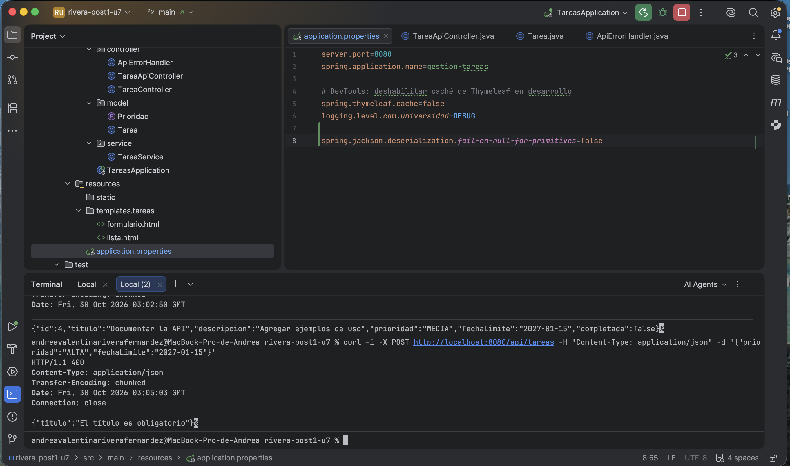

PATCH completar (200):

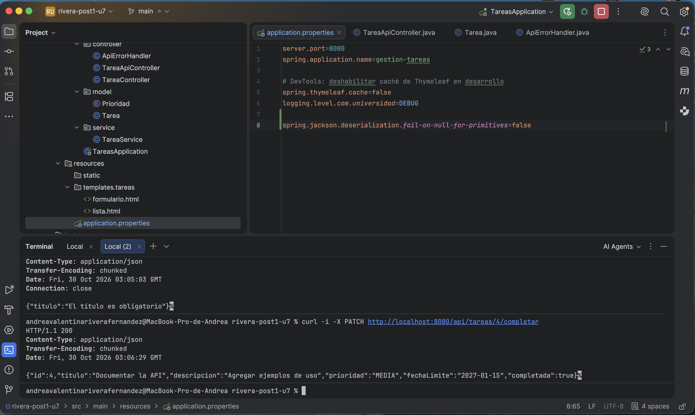

DELETE (204) y posterior consulta (404):

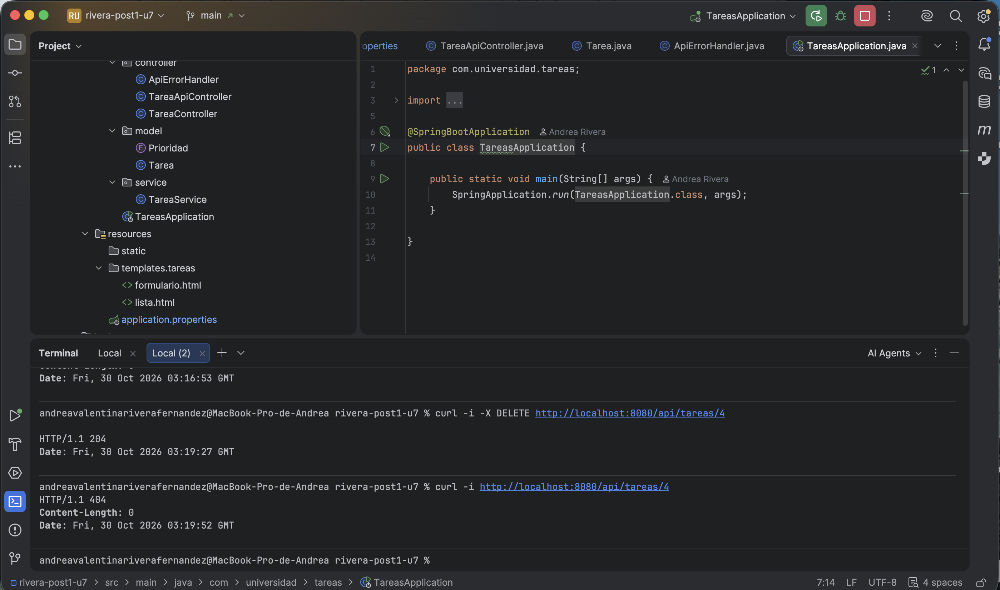

Tarea creada por la API visible en la vista web:

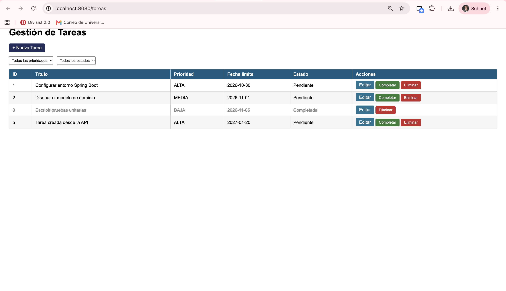

Tarea eliminada por la API desaparece de la vista web:

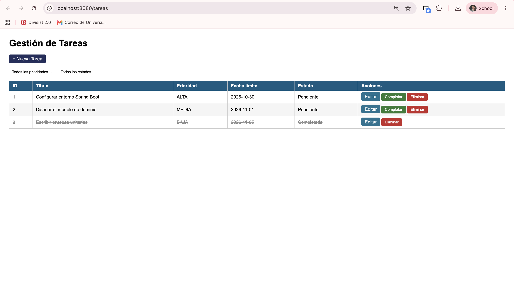